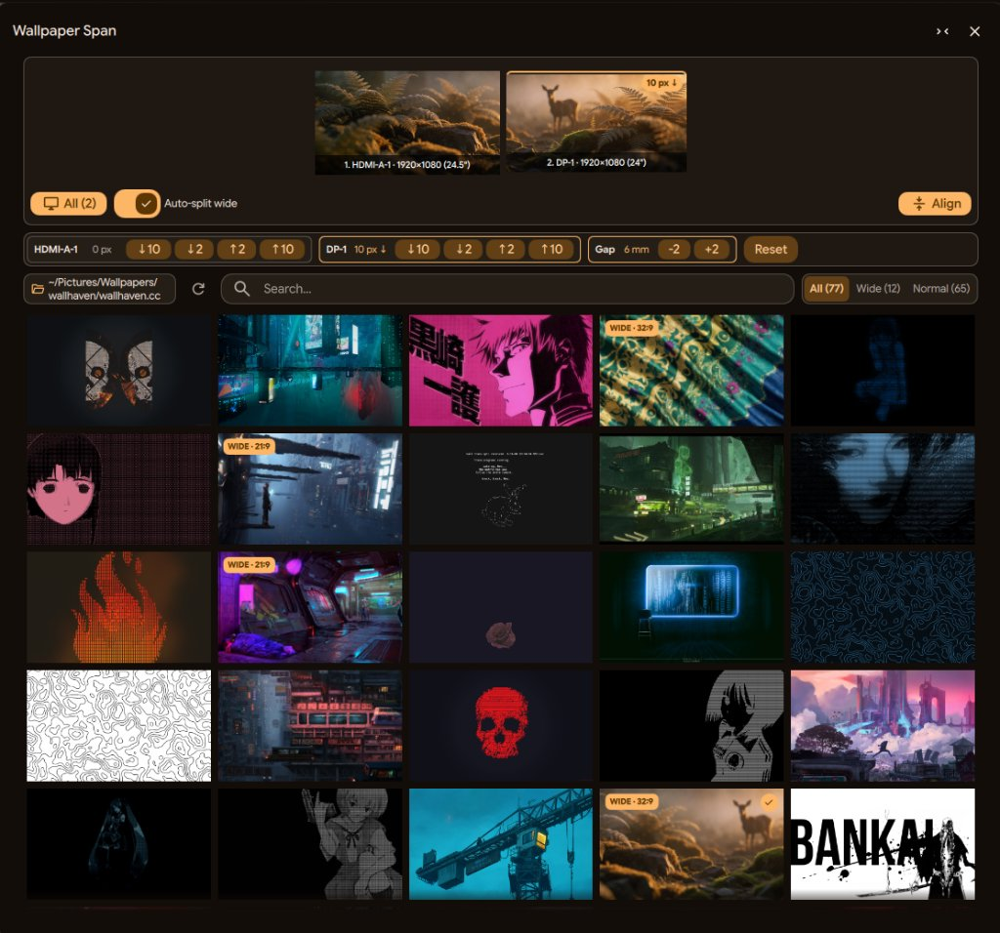

# Wallpaper Span

A DankMaterialShell (DMS) composite plugin for multi-monitor image and live video wallpapers. It supports automatic wide spanning across monitors, same wallpaper on all displays, and per-display selection.

Works on Niri, Hyprland, and other Wayland compositors supported by DMS while preserving DMS wallpaper transitions and Matugen color generation.



## Features

- **Physical-space alignment ([Spanright](https://github.com/andresjmorales/spanright) method)**: Uses monitor physical dimensions from EDID (`physical_size` on Niri or `physicalPixelDensity`), physical bezel gap in mm, and per-display vertical offset so lines cross bezels smoothly across mixed-DPI setups.
- **Live video wallpapers (`mpvpaper`)**: Scans videos (`.mp4`, `.mkv`, `.webm`, `.mov`, `.m4v`, `.avi`, `.flv`, `.wmv`) alongside images with cached `ffmpeg` thumbnails. Wide videos span across displays in real time via hardware-compatible `--video-crop` using your Spanright alignment and bezel gap.
- **Playback lifecycle & controls**: Pause/resume, stop, volume/mute, and scaling controls directly in the panel. Stops videos on screen lock or when the active Niri workspace on a display has a tiled window column (freeing RAM and CPU while keeping the still frame behind windows), restores cleanly on empty workspaces, unlock, or display hotplug, recovers crashed players, and extracts still frames via `ffmpeg` for Matugen theme updates.
- **Per-display vertical & bezel tuning**: Open **Align** in the panel to shift any monitor vertically (`↓10`, `↓2`, `↑2`, `↑10`) and adjust bezel gap (`mm`) with live preview in the monitor stage.
- **Flexible target modes**:
  - **All Displays**: Auto-spans wide images and videos (`>= 2.2:1` by default), or sets standard media across every display.
  - **Single Display**: Click a monitor at the top (or select per-card `Span` / `Same` buttons in All mode) to target an individual screen.
- **Filters & search**: Filter by `All`, `Wide`, `Normal`, or `Live`, search by filename, and browse subfolders recursively.
- **Cached static slices & thumbnails**: Split PNG slices and extracted video thumbnails/stills are cached in `~/.cache/dms/wallpaperSpan`.
- **IPC support**: Control static and live wallpapers from keybinds or scripts via `dms ipc call wallpaperSpan ...`.

## Requirements

- DankMaterialShell (DMS / `dux-shell`) `>= 2.0.0`
- `imagemagick` (`magick` or `convert`/`identify`) for image dimensions and static spanning
- Optional for live video wallpapers:
  - [`mpvpaper`](https://github.com/GhostNaN/mpvpaper) for video playback
  - `ffmpeg` and `ffprobe` for video thumbnails, dimensions, and Matugen palette stills

Install on Arch / CachyOS:

```bash
sudo pacman -S imagemagick ffmpeg mpvpaper
```

## Installation

Clone into your DMS plugins directory (or symlink your local checkout):

```bash
git clone https://github.com/Yashandyash30/wallpaper_DMS_Plugin.git ~/.config/dms/plugins/wallpaperSpan
```

Or create a symlink:

```bash
ln -s /path/to/wallpaper_DMS_Plugin ~/.config/dms/plugins/wallpaperSpan
```

Then in DMS:

1. Open **Settings → Plugins**, find **Wallpaper Span**, and enable it.
2. Add **Wallpaper Span** to your DankBar (or open it from Control Center).

## IPC Commands

```bash
dms ipc call wallpaperSpan apply /path/to/image_or_video
dms ipc call wallpaperSpan span /path/to/wide_media
dms ipc call wallpaperSpan same /path/to/normal_media
dms ipc call wallpaperSpan setMonitor DP-1 /path/to/media
dms ipc call wallpaperSpan togglePause
dms ipc call wallpaperSpan stopVideo ""
dms ipc call wallpaperSpan stopVideo DP-1
dms ipc call wallpaperSpan clearCache
```

## Development & Testing

Run the local test suite:

```bash
./tests/test_span.sh
```

## License

MIT (see [LICENSE](LICENSE))
